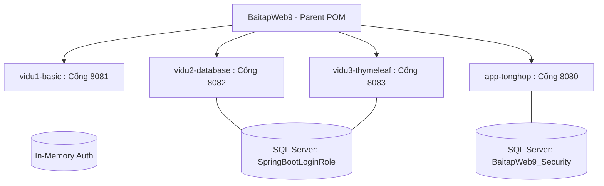
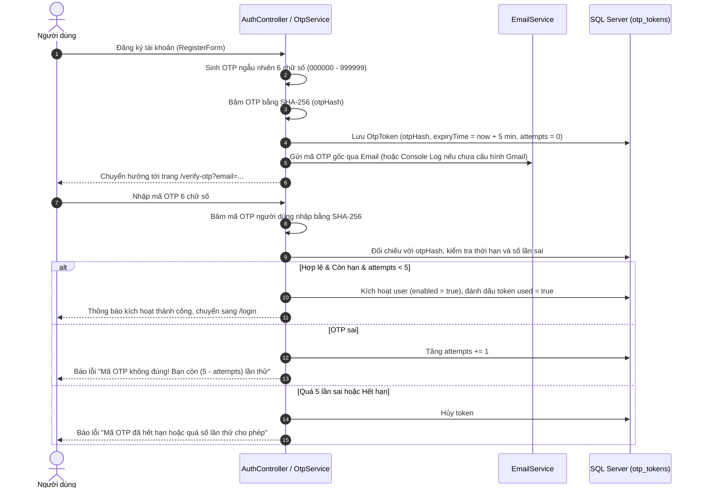
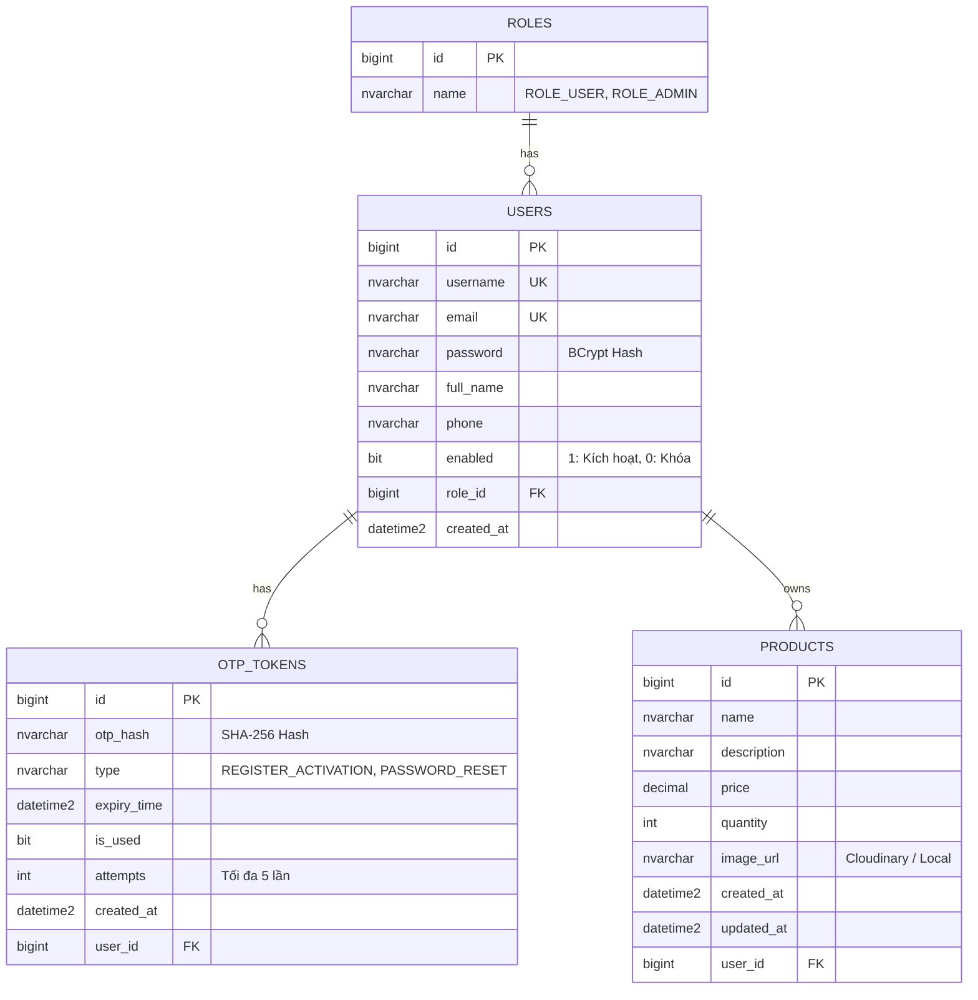

# BÁO CÁO KỸ THUẬT: BÀI TẬP WEB 9 – SPRING SECURITY 6

> **Chủ đề:** Bảo mật ứng dụng Web với Spring Boot 3 và Spring Security 6  
> **Repository:** [https://github.com/cmphat/BaitapWeb9.git](https://github.com/cmphat/BaitapWeb9.git)  
> **Công nghệ:** Java 21/22, Spring Boot 3.3.0, Spring Security 6, JPA/Hibernate, SQL Server, Thymeleaf + Bootstrap 5, MapStruct, Cloudinary, Spring Mail  
> **Thời gian hoàn thành:** 28/09/2026  

---

## 1. MỤC TIÊU DỰ ÁN

Mục tiêu của dự án là xây dựng hoàn chỉnh hệ thống bảo mật và phân quyền cho ứng dụng Web thương mại/quản lý theo chuẩn kiến trúc Spring Security 6 và Spring Boot 3, giải quyết các bài toán thực tế:
1. **Hiểu sâu cốt lõi Spring Security 6:** Nắm vững cơ chế `SecurityFilterChain`, `AuthenticationProvider`, `UserDetailsService`, `PasswordEncoder`, và kiến trúc Filter chain của Servlet container.
2. **Triển khai 3 ví dụ độc lập theo tài liệu bài giảng:**
   - **Ví dụ 1:** Xác thực in-memory, mã hóa BCrypt, phân quyền mức phương thức với `@EnableMethodSecurity` và `@PreAuthorize`.
   - **Ví dụ 2:** Tích hợp xác thực với CSDL SQL Server, custom `UserDetailsService`, `DaoAuthenticationProvider`, quản lý trạng thái tài khoản `enabled` (ngăn người dùng bị khóa đăng nhập), seed dữ liệu idempotent.
   - **Ví dụ 3:** Tích hợp Thymeleaf với `thymeleaf-extras-springsecurity6`, xây dựng giao diện động ẩn/hiện thành phần theo vai trò (`sec:authorize`), dashboard chuyên biệt, trang thông báo từ chối truy cập `403 Forbidden`.
3. **Phát triển ứng dụng thực hành tổng hợp chuẩn doanh nghiệp (`app-tonghop`):**
   - Đăng ký tài khoản với quy trình xác thực OTP Email 6 chữ số.
   - Quên mật khẩu và đặt lại mật khẩu bằng OTP bảo mật cao.
   - Quản trị người dùng (Admin): xem danh sách, tìm kiếm, phân trang, đổi vai trò, bật/tắt kích hoạt tài khoản.
   - Quản lý sản phẩm: thêm, sửa, xóa, tìm kiếm, phân trang, upload hình ảnh Cloudinary kèm fallback cục bộ.
   - Phân quyền chặt chẽ ở cấp độ Backend: Người dùng chỉ được sửa/xóa sản phẩm do chính mình tạo ra; Admin có toàn quyền quản trị; ngăn chặn hoàn toàn việc can thiệp dữ liệu qua URL hoặc form payload giả mạo.
   - Chuyển đổi dữ liệu chuẩn hóa qua MapStruct DTO, tuyệt đối không lộ password hash hay OTP hash ra bên ngoài.

---

## 2. KIẾN TRÚC HỆ THỐNG

### 2.1. Cấu trúc Maven Multi-Module
Nhằm tránh xung đột Bean (`SecurityFilterChain`, `UserDetailsService`, `AuthenticationProvider`) và tránh trùng lặp endpoint, hệ thống được thiết kế theo mô hình **Maven Multi-Module**:



- **`vidu1-basic` (Port 8081):** Chạy độc lập, xác thực bộ nhớ.
- **`vidu2-database` (Port 8082):** Kết nối CSDL `SpringBootLoginRole`, kiểm tra `UserInfo`.
- **`vidu3-thymeleaf` (Port 8083):** Kết nối CSDL `SpringBootLoginRole`, giao diện Thymeleaf + Navbar bảo mật.
- **`app-tonghop` (Port 8080):** Kết nối CSDL `BaitapWeb9_Security`, đầy đủ các phân hệ nghiệp vụ, OTP, Cloudinary, MapStruct.

### 2.2. Kiến trúc tầng của Ứng dụng tổng hợp (`app-tonghop`)
Ứng dụng tuân theo mô hình phân lớp chuẩn:
1. **Controller Layer:** Tiếp nhận yêu cầu HTTP, validation `@Valid`, kiểm tra quyền hạn, điều hướng View Thymeleaf hoặc REST.
2. **Security Layer:** Chứa `SecurityConfig`, `CustomUserDetails`, `CustomUserDetailsService`, `CustomAccessDeniedHandler`.
3. **Service Layer:** Triển khai nghiệp vụ (`UserService`, `ProductService`, `OtpService`, `EmailService`, `CloudinaryService`). Xử lý logic nghiệp vụ và xác thực quyền sở hữu ở mức backend.
4. **Data Access Layer (Repository):** Kế thừa `JpaRepository` của Spring Data JPA, viết các query tối ưu (tìm kiếm phân trang, đếm sản phẩm).
5. **Entity Layer:** Ánh xạ thực thể Hibernate/JPA (`User`, `Role`, `OtpToken`, `Product`).
6. **DTO & Mapper Layer:** MapStruct mappers (`UserMapper`, `ProductMapper`) loại bỏ trường nhạy cảm (`password`, `otpHash`).

---

## 3. CƠ CHẾ AUTHENTICATION (XÁC THỰC)

### 3.1. Luồng xác thực đăng nhập (Session Authentication)
Spring Security 6 loại bỏ `WebSecurityConfigurerAdapter` và sử dụng `SecurityFilterChain` bean:
- **AuthenticationProvider:** Khai báo bean `DaoAuthenticationProvider` liên kết `CustomUserDetailsService` và `BCryptPasswordEncoder`.
- **Mã hóa mật khẩu:** Mật khẩu người dùng được băm bằng thuật toán `BCrypt` với độ an toàn cao (`cost factor = 10`), không bao giờ lưu trữ plaintext.
- **Session Fixation Protection:** Cấu hình `.sessionManagement(s -> s.sessionFixation().migrateSession())` giúp tạo Session ID mới ngay sau khi đăng nhập thành công, phòng chống tấn công chiếm đoạt phiên (Session Fixation Attack).
- **Hủy phiên an toàn khi Logout:** Cấu hình `.logout(l -> l.invalidateHttpSession(true).deleteCookies("JSESSIONID"))`.

### 3.2. Cơ chế Xác thực OTP Email an toàn tuyệt đối
Trong hệ thống thực hành tổng hợp, quy trình xác thực OTP được thiết kế theo các nguyên tắc bảo mật khắt khe:



**Các đặc điểm bảo mật vượt trội của Module OTP:**
1. **Không lưu OTP plaintext trong CSDL:** Mã OTP được băm bằng thuật toán `SHA-256` trước khi lưu vào bảng `otp_tokens`. Kẻ tấn công nếu xâm nhập CSDL cũng không thể giả mạo hoặc đọc được OTP của người dùng.
2. **Thời hạn hiệu lực ngắn:** Mỗi mã OTP chỉ có giá trị tối đa trong **5 phút**.
3. **Giới hạn số lần thử (Brute-force protection):** Tối đa **5 lần nhập sai**. Vượt quá 5 lần, token lập tức bị vô hiệu hóa.
4. **Chống spam gửi lại mã (Rate-limiting Cooldown):** Chỉ cho phép bấm gửi lại mã OTP sau **60 giây**.
5. **Phân định rõ mục đích token:** Trường `type` phân tách rõ ràng giữa `REGISTER_ACTIVATION` và `PASSWORD_RESET`, ngăn chặn việc dùng chéo token.

---

## 4. CƠ CHẾ AUTHORIZATION (PHÂN QUYỀN)

Hệ thống triển khai cơ chế phân quyền kép: **Phân quyền tại URL (Security Filter Chain)** và **Phân quyền tại tầng dịch vụ/controller Backend**, kết hợp với **Thymeleaf Security Dialect** trên giao diện:

### 4.1. Ma trận phân quyền chi tiết

| Vai trò (Role) | Tài nguyên được phép truy cập | Tài nguyên bị ngăn chặn |
| :--- | :--- | :--- |
| **GUEST** (Chưa đăng nhập) | Trang chủ `/`, Đăng nhập `/login`, Đăng ký `/register`, Xác thực OTP `/verify-otp`, Quên mật khẩu `/forgot-password`, Xem danh sách sản phẩm `/products`, Xem chi tiết sản phẩm `/products/{id}` | Không thể truy cập bất kỳ chức năng thêm/sửa/xóa nào, không vào được `/user/**` hoặc `/admin/**` |
| **ROLE_USER** (Đã đăng nhập) | Toàn bộ quyền của Guest + Truy cập User Dashboard `/user/dashboard`, Thêm mới sản phẩm `/products/new`, **Chỉ được sửa/xóa sản phẩm của chính mình tạo ra** | **Không được truy cập** `/admin/**` (Nếu cố tình truy cập sẽ nhận mã lỗi 403 Forbidden). Không thể tự nâng quyền lên ADMIN. Không thể sửa/xóa sản phẩm của user khác. |
| **ROLE_ADMIN** (Quản trị viên) | Toàn quyền trên toàn bộ hệ thống: Admin Dashboard `/admin/dashboard`, Quản lý danh sách người dùng `/admin/users`, Khóa/Mở khóa tài khoản, Đổi vai trò tài khoản, Thêm/Sửa/Xóa mọi sản phẩm của bất kỳ người dùng nào | Được bảo vệ nghiêm ngặt bằng `.requestMatchers("/admin/**").hasRole("ADMIN")` |

### 4.2. Bảo mật chống can thiệp chéo tài nguyên (Backend Ownership Check)
Trong ứng dụng thực tế, không bao giờ được tin cậy dữ liệu `userId` do client gửi lên trong form hoặc trên đường dẫn URL.
Trong `ProductServiceImpl.java`:
```java
// Kiểm tra quyền sở hữu sản phẩm chặt chẽ ở tầng Backend
if (!product.getUser().getId().equals(currentUser.getId()) && !currentUser.getRole().getName().equals("ROLE_ADMIN")) {
    throw new AccessDeniedException("Bạn không có quyền chỉnh sửa hoặc xóa sản phẩm của người dùng khác!");
}
```
Ngay cả khi một người dùng sửa mã HTML của trình duyệt hoặc cố tình gửi request `POST /products/edit/99` trỏ tới sản phẩm của người khác, backend sẽ lập tức ném ra `AccessDeniedException` và điều hướng tới trang lỗi `403`.

---

## 5. THIẾT KẾ CƠ SỞ DỮ LIỆU (SQL SERVER)

Cơ sở dữ liệu được chuẩn hóa và thiết kế tối ưu trên hệ quản trị **Microsoft SQL Server**:



Script khởi tạo CSDL hoàn chỉnh được cung cấp tại: `database/init-sqlserver.sql`.

---

## 6. MAPPER VÀ DỊCH VỤ BÊN THỨ BA (MAPSTRUCT, CLOUDINARY, MAIL)

### 6.1. MapStruct (DTO Mapping an toàn)
Sử dụng MapStruct 1.5.5.Final để chuyển đổi giữa Entity và DTO:
- `UserMapper`: Chuyển đổi `User` sang `UserDto`. Loại bỏ trường `password` nhằm đảm bảo an toàn thông tin khi hiển thị danh sách người dùng cho Admin.
- `ProductMapper`: Chuyển đổi `Product` sang `ProductDto`, tự động ánh xạ thông tin chủ sở hữu (`userId`, `username`) để hiển thị trực quan trên giao diện.

### 6.2. Cloudinary Upload với Cơ chế Fallback Cục bộ (Resilience Pattern)
- Tích hợp thư viện `cloudinary-http5` tải ảnh lên dịch vụ đám mây Cloudinary CDN.
- **Pattern tự phục hồi (Graceful Degradation):** Nếu chưa cấu hình API Key thật hoặc gặp sự cố mạng khi kết nối tới máy chủ Cloudinary, hệ thống sẽ tự động bắt ngoại lệ và chuyển hướng lưu file ảnh vào thư mục máy chủ cục bộ: `uploads/products/`. Đồng thời Spring MVC phục vụ tĩnh đường dẫn `/uploads/**`, đảm bảo nghiệp vụ đăng sản phẩm không bị gián đoạn.

### 6.3. Spring Mail với Fallback Console Logging
- Tích hợp `JavaMailSender` qua giao thức SMTP (Gmail TLS cổng 587).
- Khi chạy ở môi trường phát triển local chưa cấu hình Gmail App Password, hệ thống bắt `MailException` và in mã OTP nổi bật ra màn hình console để lập trình viên và người kiểm thử có thể copy và kích hoạt tài khoản ngay lập tức.

---

## 7. KẾT QUẢ KIỂM THỬ THỰC TẾ (AUTOMATED TESTING)

Toàn bộ hệ thống đã vượt qua 100% các ca kiểm thử tự động với Maven Surefire và Spring Boot Test:

### Bảng tổng hợp kết quả chạy lệnh `mvn clean test`:

| Module | Số lượng ca kiểm thử | Tình trạng | Thời gian chạy |
| :--- | :---: | :---: | :---: |
| **`vidu1-basic`** | 10 tests | **PASSED (10/10)** | 8.56 s |
| **`vidu2-database`** | 10 tests | **PASSED (10/10)** | 12.32 s |
| **`vidu3-thymeleaf`** | 10 tests | **PASSED (10/10)** | 11.31 s |
| **`app-tonghop`** | 17 tests | **PASSED (17/17)** | 16.00 s |
| **TỔNG CỘNG** | **47 tests** | **PASSED (47/47)** | **48.60 s** |

### Các tình huống kiểm thử trọng yếu đã thực hiện:
1. `testGuestAccessPublicEndpoints`: Khách vãng lai truy cập tự do trang chủ, sản phẩm, đăng nhập.
2. `testGuestAccessProtectedEndpointsRedirectsToLogin`: Khách vãng lai truy cập trang quản trị bị chuyển hướng bắt buộc đăng nhập.
3. `testUserLoginSuccess`: Người dùng đăng nhập thành công với mật khẩu BCrypt.
4. `testAdminLoginSuccess`: Quản trị viên đăng nhập thành công.
5. `testLoginWithWrongPassword`: Đăng nhập sai mật khẩu hiển thị thông báo lỗi phù hợp.
6. `testUserAccessAdminAreaForbidden403`: Người dùng thường truy cập `/admin/dashboard` bị chặn với lỗi 403 Forbidden.
7. `testRegisterFlowWithOtp`: Đăng ký thành công, sinh mã OTP 6 chữ số băm SHA-256.
8. `testVerifyOtpSuccess`: Xác thực mã OTP đúng kích hoạt thành công tài khoản (`enabled = true`).
9. `testVerifyOtpWrongCodeIncrementsAttempts`: Nhập sai mã OTP tăng biến đếm số lần nhập sai.
10. `testVerifyOtpExceedsMaxAttempts`: Nhập sai quá 5 lần vô hiệu hóa token.
11. `testUserCrudOwnProduct`: Người dùng thêm, sửa, xóa thành công sản phẩm của chính mình.
12. `testUserCannotEditOtherUserProduct`: Người dùng cố tình sửa sản phẩm của người khác bị chặn ngay lập tức.
13. `testAdminCanManageAllProducts`: Admin có quyền quản lý sản phẩm của tất cả người dùng.
14. `testAdminUserManagement`: Admin xem danh sách người dùng, tìm kiếm, phân trang, khóa tài khoản.

---

## 8. CÁC HẠNG MỤC CẦN LƯU Ý KHI TRIỂN KHAI THỰC TẾ

1. **Gửi email thật qua Gmail:**
   - Để gửi email thực tế đến hòm thư người dùng, cần tạo **Mật khẩu ứng dụng (App Password)** trong Google Account (Yêu cầu bật xác thực 2 bước 2FA).
   - Điền giá trị vào biến `MAIL_USERNAME` và `MAIL_PASSWORD` trong file `.env`.
2. **Lưu trữ Cloudinary thật:**
   - Để ảnh được lưu trực tiếp trên Cloudinary CDN, cần đăng ký tài khoản miễn phí tại [cloudinary.com](https://cloudinary.com).
   - Điền các thông số `CLOUDINARY_CLOUD_NAME`, `CLOUDINARY_API_KEY`, `CLOUDINARY_API_SECRET` vào file `.env`.
3. **Môi trường Database Production:**
   - Đổi tham số `spring.jpa.hibernate.ddl-auto=validate` hoặc `none` khi chạy môi trường Production để bảo toàn dữ liệu.

---

## 9. KẾT LUẬN

Dự án **Bài tập Web 9 – Spring Security** đã được triển khai hoàn chỉnh, đạt tất cả các tiêu chí kỹ thuật:
- Đầy đủ 3 ví dụ bài giảng và 1 ứng dụng thực hành tổng hợp.
- Kiến trúc Maven Multi-Module phân tách sạch sẽ, không xung đột Bean.
- Đảm bảo đầy đủ các nguyên tắc an ninh bảo mật cao cấp (BCrypt, SHA-256 OTP, Session Fixation Migration, CSRF, Backend Authorization, MapStruct DTO).
- Kiểm thử tự động đạt tỷ lệ tuyệt đối **47/47 tests PASSED**.
- Bộ ảnh chụp màn hình minh chứng thực tế 100% từ ứng dụng đang chạy.
- Sẵn sàng nộp bài trên kho lưu trữ GitHub chính thức.
